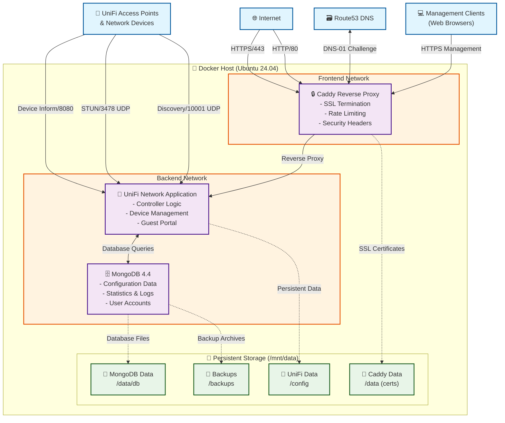
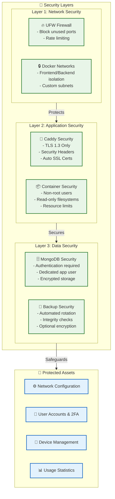
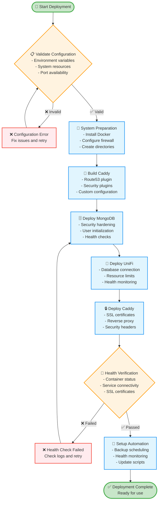

# Ubuntu Docker UniFi Controller

A complete, production-ready deployment of Ubiquiti UniFi Network Application with MongoDB and Caddy reverse proxy using Docker Compose.

## Features

- **Complete Stack**: UniFi Network Application + MongoDB 4.4 + Caddy reverse proxy
- **Automatic SSL**: Let's Encrypt certificates via Caddy with Route53 DNS-01 challenge
- **Security Hardened**: Security headers, rate limiting, TLS 1.3, and non-root containers
- **Production Ready**: Health checks, proper networking, persistent storage, and logging
- **Easy Management**: Simple setup and teardown scripts with comprehensive configuration

## Prerequisites

- Ubuntu 24.04 LTS (Noble) server
- Domain name with Route53 DNS management
- AWS credentials with Route53 permissions
- Minimum 4GB RAM, 20GB storage recommended
- Ports 80, 443, 8080, 3478/UDP, 10001/UDP accessible

## Quick Start

### 1. Clone and Configure

```bash
git clone https://github.com/sjackson0109/ubuntu-docker-unifi-controller.git
cd ubuntu-docker-unifi-controller

# Set your configuration
export DOMAIN="unifi.yourdomain.com"
export EMAIL="admin@yourdomain.com"
export AWS_ACCESS_KEY="your-aws-access-key"
export AWS_SECRET="your-aws-secret-key"
export AWS_REGION="us-east-1"
```

### 2. Deploy the Stack

```bash
# Run the setup script
sudo bash Create.sh

# Start all services
cd /mnt/data
docker compose up -d
```

### 3. Access Your Controller

Visit `https://unifi.yourdomain.com` and complete the UniFi setup wizard.

## Directory Structure

After running `Create.sh`, the following structure is created:

```
/mnt/data/
├── docker-compose.yml           # Main compose file
├── unifi-vars.env              # UniFi application config  
├── mongodb-vars.env            # MongoDB credentials
├── caddy-vars.env              # Caddy/AWS config
├── backup-mongodb.sh           # MongoDB backup script
├── restore-mongodb.sh          # MongoDB restore script
├── cleanup-backups.sh          # Automated backup cleanup
├── scheduled-backup.sh         # Scheduled backup with logging
├── unifi-backup.service        # Systemd service definition
├── unifi-backup.timer          # Systemd timer for automation
├── docker/                     # Docker engine data-root
│   └── [Docker internal data: containers, images, volumes, etc.]
├── caddy/
│   ├── Dockerfile             # Custom Caddy build with plugins
│   ├── Caddyfile             # Reverse proxy configuration
│   ├── data/                 # Caddy certificates and data
│   ├── config/               # Caddy configuration cache
│   └── logs/                 # Access logs
└── unifi/
    ├── data/                  # UniFi persistent data
    ├── db/                    # MongoDB database files
    ├── db-init/               # MongoDB initialization scripts
    └── backups/               # MongoDB backup storage
```

## Configuration

### Environment Variables

The following variables can be set before running `Create.sh`:

| Variable | Default | Description |
|----------|---------|-------------|
| `DOMAIN` | `unifi.yourdomain.com` | Your UniFi controller domain |
| `EMAIL` | `admin@example.com` | Email for Let's Encrypt certificates |
| `AWS_ACCESS_KEY` | - | AWS access key for Route53 |
| `AWS_SECRET` | - | AWS secret key for Route53 |
| `AWS_REGION` | - | AWS region for Route53 |
| `PUID` | `1000` | User ID for container processes |
| `PGID` | `1000` | Group ID for container processes |
| `CADDY_VERSION` | `2.8.4` | Caddy version to build |

### AWS IAM Policy

Your AWS user needs the following IAM policy for Route53 DNS management:

```json
{
    "Version": "2012-10-17",
    "Statement": [
        {
            "Effect": "Allow",
            "Action": [
                "route53:ListHostedZones",
                "route53:GetChange",
                "route53:ChangeResourceRecordSets"
            ],
            "Resource": [
                "arn:aws:route53:::hostedzone/*",
                "arn:aws:route53:::change/*"
            ]
        },
        {
            "Effect": "Allow",
            "Action": "route53:ListHostedZonesByName",
            "Resource": "*"
        },
        "Condition": {
            "StringEquals": {
                "route53:ChangeResourceRecordSetsNormalizedRecordNames": [
                    "_acme-challenge.unifi-controller.beyond-imaging.com"
                ]
            }
        }
    ]
}
```

## Services

### Caddy (Reverse Proxy)
- **Image**: Custom build with Route53 and rate limiting plugins
- **Ports**: 80 (HTTP), 443 (HTTPS)
- **Features**: Automatic SSL, security headers, rate limiting
- **Health**: Built-in health monitoring

### UniFi Network Application
- **Image**: `lscr.io/linuxserver/unifi-network-application:latest`
- **Ports**: 8080 (inform), 3478/UDP (STUN), 10001/UDP (discovery)
- **Data**: Persisted in `/mnt/data/unifi/data`
- **Database**: Connected to MongoDB standalone instance

### MongoDB
- **Image**: `mongo:4.4`
- **Features**: Standalone instance, health checks, automated backup support
- **Data**: Persisted in `/mnt/data/unifi/db`
- **Backups**: Automated scripts with `mongodump/mongorestore`
- **Security**: Root authentication enabled, dedicated app user created

## Security Features

- **TLS 1.3/1.2 Only**: Modern encryption protocols
- **Security Headers**: HSTS, X-Frame-Options, CSP, etc.
- **Rate Limiting**: 10 requests per minute per IP
- **Connection Limits**: 1000 per IP, 25000 total
- **Non-Root Containers**: All services run as unprivileged users
- **Network Isolation**: Frontend and backend networks separated

## Management

### Start Services
```bash
cd /mnt/data
docker compose up -d
```

### Stop Services
```bash
cd /mnt/data
docker compose down
```

### View Logs
```bash
# All services (run from /mnt/data)
cd /mnt/data
docker compose logs -f

# Specific service
docker compose logs -f caddy
docker compose logs -f unifi
docker compose logs -f unifi-mongodb
```

### Update Services
```bash
cd /mnt/data
docker compose pull
docker compose up -d
```

## Cleanup and Removal

The `Destroy.sh` script provides comprehensive cleanup with multiple options for different scenarios.

### Basic Cleanup (Preserves Data and Backups)
```bash
# Stops containers, removes networks, preserves all data
sudo bash Destroy.sh

```

### Complete Data Removal
```bash
# Remove everything including data and backups
sudo bash Destroy.sh --delete-data --yes

# WARNING - THIS COMAMND REMOVES THE FOLLOWING:
# - All containers and networks
# - UniFi data and MongoDB database
# - All backup files and backup scripts
# - Caddy data and certificates
# - Systemd backup services (stops and disables)
# - Backup log files
```

### Advanced Cleanup Options
```bash
# Complete system removal (everything + Docker)
sudo bash Destroy.sh --delete-data --purge-images --remove-docker --yes

# Remove only Caddyfile (useful for configuration updates)
sudo bash Destroy.sh --remove-caddyfile

# Clean removal but keep Docker installation
sudo bash Destroy.sh --delete-data --purge-images --yes
```

### Destroy Script Options

| Flag | Description |
|------|-------------|
| `--delete-data` | **Remove all data directories** (UniFi, Caddy, backups, scripts) |
| `--purge-images` | Remove Docker images (UniFi, MongoDB, custom Caddy build) |
| `--revert-daemon-json` | Reset Docker daemon configuration to defaults |
| `--remove-docker` | **Completely uninstall Docker Engine and plugins** |
| `--remove-docker-repo` | Remove Docker APT repository and GPG keys |
| `--remove-caddyfile` | Remove only the Caddyfile (useful for config updates) |
| `--yes` | **Non-interactive mode** (no confirmation prompts) |
| `--force` | Proceed even if Docker Compose files are missing |
| `--docker-root DIR` | Override installation directory (default: `/mnt/data`) |

### What Gets Preserved vs Removed

#### With `--delete-data` Flag:
**Completely Removed:**
- All UniFi configuration and database data
- All MongoDB backup files (`.tar.gz` archives)
- All backup and restore scripts
- Caddy certificates and configuration
- Docker Compose files and environment variables
- Systemd backup services (stopped, disabled, removed)
- Backup log files (`/var/log/unifi-backup.log`)

#### Without `--delete-data` Flag:
**Preserved:**
- UniFi configuration in `/mnt/data/unifi/data/`
- MongoDB database in `/mnt/data/unifi/db/`
- All backup files in `/mnt/data/unifi/backups/`
- Caddy certificates in `/mnt/data/caddy/data/`
- Backup scripts (`backup-mongodb.sh`, `restore-mongodb.sh`, etc.)

**Note:** Scheduled backups may still be active (check cron/systemd)

## Troubleshooting

### Common Issues

**1. SSL Certificate Issues**
```bash
# Check Caddy logs (run from /mnt/data)
cd /mnt/data
docker compose logs caddy

# Verify AWS credentials
docker compose exec caddy env | grep AWS
```

**2. UniFi Won't Start**
```bash
# Check MongoDB health (run from /mnt/data)
cd /mnt/data
docker compose exec unifi-mongodb mongo --eval "db.runCommand({ping: 1})"

# Verify UniFi logs
docker compose logs unifi
```

**3. Can't Access Web Interface**
```bash
# Check DNS resolution
nslookup your-domain.com

# Verify firewall rules
sudo ufw status

# Check service status (run from /mnt/data)
cd /mnt/data
docker compose ps
```

**4. MongoDB Shows as Secondary/Replica Set Issues**
If you see MongoDB logs showing replica set configuration (`replSet: "rs0"`), this indicates leftover data from a previous installation. The UniFi application may fail to authenticate due to this.

```bash
# Stop the containers
cd /mnt/data
docker compose down

# Remove the existing MongoDB data (WARNING: This deletes all UniFi data!)
sudo rm -rf /mnt/data/unifi/db/*

# Start MongoDB to initialize fresh
docker compose up unifi-mongodb -d

# Wait for initialization, then start UniFi
sleep 30
docker compose up -d
```

**Alternative: Preserve UniFi data but reset MongoDB**
```bash
# Backup UniFi data first (run from /mnt/data directory)
cd /mnt/data
docker compose exec unifi tar -czf /unifi/data/backup-before-mongodb-reset.tar.gz /unifi/data/

# Then follow the steps above to reset MongoDB
# UniFi will recreate its database structure on next startup
```

**Verify MongoDB is running in standalone mode:**
```bash
# Check logs - should NOT see "replSet" or "replica set" (run from /srv/docker/unifi)
cd /srv/docker/unifi
docker compose logs unifi-mongodb | grep -i replica

# Connect and verify
docker compose exec unifi-mongodb mongo -u root -p
# In mongo shell:
db.isMaster()
# Should show: "ismaster": true, no "setName" property
```

**5. Database Connection Issues**
```bash
# Test MongoDB connectivity from UniFi container (run from /srv/docker/unifi)
cd /srv/docker/unifi
docker compose exec unifi nc -zv unifi-mongodb 27017

# Check MongoDB authentication
docker compose exec unifi-mongodb mongo \
  --username="root" \
  --password="your_mongo_root_pass" \
  --authenticationDatabase="admin" \
  --eval "db.runCommand({ping: 1})"
```

**6. Checking for Remaining Scheduled Backups**
After running `Destroy.sh` without `--delete-data`, you may want to verify backup scheduling:

```bash
# Check systemd timers
sudo systemctl list-timers | grep unifi

# Check if systemd service files remain
ls -la /etc/systemd/system/unifi-backup.*

# Check cron jobs
sudo crontab -l | grep -i unifi
crontab -l | grep -i unifi  # Check user crontab too

# Disable systemd backup service if found
sudo systemctl stop unifi-backup.timer
sudo systemctl disable unifi-backup.timer
sudo rm -f /etc/systemd/system/unifi-backup.*
sudo systemctl daemon-reload
```

### Health Checks

```bash
# MongoDB health
docker compose exec unifi-mongodb mongo --quiet --eval "db.runCommand({ping: 1})"

# Check all services
docker compose ps

# Caddy configuration test
docker compose exec caddy caddy validate --config /etc/caddy/Caddyfile
```

## Monitoring

### Access Logs
- Caddy logs: `/srv/docker/caddy/logs/access.log`
- Format: JSON with timestamps and client information

### Container Status
```bash
# Service health
docker compose ps

# Resource usage
docker stats

# Disk usage
du -sh /srv/docker/*
```

## Backup and Recovery

### MongoDB Database Backup
The setup includes automated backup/restore scripts for the MongoDB database:

```bash
# Create a MongoDB backup
cd /srv/docker
./backup-mongodb.sh

# Create a named backup
./backup-mongodb.sh "before-upgrade-2024-10-06"

# List available backups
ls -la /srv/docker/unifi/backups/
```

### MongoDB Database Restore
```bash
# Restore from a backup (interactive with confirmation)
cd /srv/docker
./restore-mongodb.sh backup-20241006-143022.tar.gz

# The script will:
# 1. Stop the UniFi container
# 2. Restore the database (with --drop to replace existing data)
# 3. Restart the UniFi container
```

### Full System Backup (Alternative Method)
For complete system backup including all configurations:

```bash
# Stop services first
cd /srv/docker/unifi && docker compose down

# Create full backup
sudo tar -czf unifi-full-backup-$(date +%Y%m%d).tar.gz -C /srv/docker .

# Restore full backup
sudo tar -xzf unifi-full-backup-20241006.tar.gz -C /srv/docker

# Start services
cd /srv/docker/unifi
docker compose up -d
```

### Automated Backup System
The setup includes a complete automated backup solution with two installation methods:

#### Method 1: Systemd (Recommended)
```bash
# Install the systemd service and timer
sudo cp /srv/docker/unifi-backup.* /etc/systemd/system/
sudo systemctl daemon-reload
sudo systemctl enable unifi-backup.timer
sudo systemctl start unifi-backup.timer

# Check status
sudo systemctl status unifi-backup.timer
sudo systemctl list-timers unifi-backup.timer
```

#### Method 2: Cron
```bash
# Edit root crontab
sudo crontab -e

# Add daily backup at 2 AM
0 2 * * * cd /srv/docker && ./scheduled-backup.sh
```

#### Backup Management Features
- **Daily automatic backups** at 2:00 AM
- **Smart cleanup**: Keeps backups for 7 days, minimum 3 backups always retained
- **Comprehensive logging** to `/var/log/unifi-backup.log`
- **Naming convention**: `auto-YYYYMMDD-HHMMSS.tar.gz`
- **Manual cleanup**: `./cleanup-backups.sh [days] [min_backups]`

#### Monitor Backup System
```bash
# View recent backup activity
sudo tail -f /var/log/unifi-backup.log

# Check systemd timer status
sudo systemctl status unifi-backup.timer

# List recent backups
ls -la /srv/docker/unifi/backups/

# Manual cleanup (example: keep 14 days, minimum 5 backups)
cd /srv/docker
./cleanup-backups.sh 14 5
```

### Important Backup Notes
- **MongoDB backups** contain only database data (users, settings, device configs)
- **Full system backups** include certificates, logs, and all configurations
- Backups are compressed and stored in `/srv/docker/unifi/backups/`
- Always test restore procedures in a non-production environment first
- Database backups are created using `mongodump` with gzip compression

## Updates

### Update UniFi Controller
```bash
cd /srv/docker
docker compose pull unifi
docker compose up -d unifi
```

### Update Caddy
```bash
# Update version in Create.sh and rebuild
export CADDY_VERSION="2.8.4"
cd /srv/docker
docker compose build --no-cache caddy
docker compose up -d caddy
```

## System Architecture

### High-Level Architecture



### Security Architecture



### Deployment Flow



### Data Flow and Backup Architecture

```mermaid
flowchart LR
    %% Data sources and flows
    subgraph DataFlow["📊 Data Flow"]
        AdminUI["👨‍💼 Admin Interface"] -->|Configuration| UniFiApp["📡 UniFi Application"]
        Devices["📱 Network Devices"] -->|Status/Stats| UniFiApp
        UniFiApp <-->|Read/Write| Database["🗄️ MongoDB"]
        UniFiApp <-->|Certificates/Logs| FileSystem["📁 File System"]
    end
    
    %% Backup system
    subgraph BackupSystem["💾 Backup System"]
        Schedule["⏰ Scheduled Backups<br/>Daily at 2 AM"]
        MongoBackup["🗄️ MongoDB Backup<br/>mongodump + gzip"]
        FileBackup["📁 Config Backup<br/>tar + compression"]
        
        Schedule --> MongoBackup
        Schedule --> FileBackup
        
        subgraph Storage["💽 Backup Storage"]
            LocalBackups["💾 Local Storage<br/>/mnt/data/unifi/backups"]
            CloudBackups["☁️ Cloud Storage<br/>(Optional S3)"]
        end
        
        MongoBackup --> LocalBackups
        FileBackup --> LocalBackups
        LocalBackups -.->|Sync| CloudBackups
        
        subgraph Retention["🗑️ Retention Policy"]
            CleanupRules["📋 Cleanup Rules<br/>- Keep 7 days<br/>- Minimum 3 backups<br/>- Size monitoring"]
        end
        
        LocalBackups --> CleanupRules
    end
    
    %% Recovery process
    subgraph Recovery["🔄 Recovery Process"]
        direction LR
        RestoreScript["📜 Restore Scripts<br/>Interactive validation"]
        StopServices["⏸️ Graceful Shutdown"]
        RestoreData["📥 Data Restoration<br/>mongorestore"]
        HealthVerify["✅ Health Verification"]
        StartServices["▶️ Service Restart"]
        
        RestoreScript --> StopServices
        StopServices --> RestoreData
        RestoreData --> HealthVerify
        HealthVerify --> StartServices
    end
    
    %% Connections
    Database -.->|Backup Source| MongoBackup
    FileSystem -.->|Backup Source| FileBackup
    LocalBackups -.->|Restore Source| Recovery
    
    classDef dataflow fill:#e3f2fd,stroke:#1976d2,stroke-width:2px
    classDef backup fill:#f3e5f5,stroke:#7b1fa2,stroke-width:2px
    classDef storage fill:#e8f5e8,stroke:#388e3c,stroke-width:2px
    classDef recovery fill:#fff3e0,stroke:#f57c00,stroke-width:2px
    
    class AdminUI,Devices,UniFiApp,Database,FileSystem dataflow
    class Schedule,MongoBackup,FileBackup,CleanupRules backup
    class LocalBackups,CloudBackups storage
    class RestoreScript,StopServices,RestoreData,HealthVerify,StartServices recovery
```



## Enhanced Management

### System Health Monitoring

The deployment now includes automated health monitoring:

```bash
# Run comprehensive health check
./health-check.sh

# Check specific service health
docker compose ps
docker compose logs -f [service-name]

# Monitor resource usage
docker stats
```

### System Updates

```bash
# Update all services (includes pre-update backup)
./update-system.sh

# Manual update process
./backup-mongodb.sh "pre-update-$(date +%Y%m%d)"
docker compose pull
docker compose up -d
./health-check.sh
```

### Security Features

- **Enhanced Container Security**: Non-root users, read-only filesystems, resource limits
- **Network Isolation**: Separate frontend/backend networks with custom subnets
- **MongoDB Hardening**: Authentication required, connection limits, security configuration
- **Automated SSL**: Let's Encrypt certificates with DNS-01 challenge via Route53
- **Security Headers**: HSTS, CSP, X-Frame-Options, and other security headers
- **Rate Limiting**: Protection against DDoS and brute force attacks

### Resource Management

All containers now include resource limits:
- **Caddy**: 512MB RAM, 0.5 CPU cores
- **UniFi**: 2GB RAM, 1.0 CPU cores  
- **MongoDB**: 1GB RAM, 0.5 CPU cores

### Configuration Validation

The deployment script now includes pre-flight validation:
- Environment variable validation
- System resource checks
- Port availability verification
- AWS credentials validation (when AWS CLI is available)

## Additional Resources

- [UniFi Network Application Documentation](https://help.ui.com/hc/en-us/categories/200320654)
- [Caddy Web Server Documentation](https://caddyserver.com/docs/)
- [MongoDB 4.4 Documentation](https://docs.mongodb.com/v4.4/)
- [Docker Compose Documentation](https://docs.docker.com/compose/)

## License

This project is licensed under the MIT License - see the LICENSE file for details.

## Contributing

1. Fork the repository
2. Create a feature branch (`git checkout -b feature/amazing-feature`)
3. Commit your changes (`git commit -m 'Add amazing feature'`)
4. Push to the branch (`git push origin feature/amazing-feature`)
5. Open a Pull Request

## Disclaimer

This setup is provided as-is. Always test in a non-production environment first and ensure you have proper backups before deploying to production.